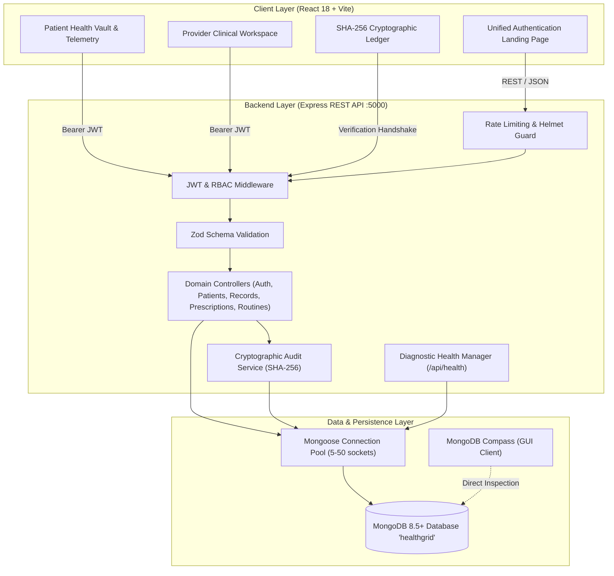

# HealthGrid Enterprise Lifetime Health Record & Intelligence Node

> **Enterprise Full-Stack Electronic Health Record (EHR) & Clinical Intelligence Platform**  
> Built with **React 18 + Vite** (Frontend), **Node.js + Express** (Backend), **MongoDB + Mongoose** (Database), and a **Cryptographic SHA-256 Audit Ledger**.

Reference Deployed Design: [https://taru30174.github.io/healthgrid/](https://taru30174.github.io/healthgrid/)  
Requirements Audit & Traceability Matrix: [docs/requirements-audit.md](docs/requirements-audit.md)

---

## 1. Project Purpose & Architecture

HealthGrid is an enterprise medical information aggregation and clinical workflow node designed for high-integrity healthcare data management. It provides individuals with an encrypted, unified lifetime health record (from birth to present), enables proactive health adherence tracking, supports simulated document digitization, and equips licensed physicians with an active caseload management console, cross-provider exchange queries (ABDM), and digital e-prescription signing.

Every state-changing operation (creates, updates, and deletes) is permanently sealed in an append-only, SHA-256 chained audit ledger, enabling cryptographic verification of ledger integrity against unauthorized database tampering.



| Layer | Technologies |
|---|---|
| **Frontend Framework** | React 18, Vite 5, Lucide React (Icons), Chart.js & react-chartjs-2 (Visualizations) |
| **Styling & Design** | Pure Modern CSS, Custom Design System (Clinical Emerald & Indigo Themes, Glassmorphism) |
| **Backend Framework** | Node.js (ESM), Express.js 4.19+ |
| **Security & Middleware** | Helmet (Headers), CORS, Express Rate Limit (Auth endpoints), Bcryptjs (10 rounds), JsonWebToken (JWT) |
| **Validation** | Zod (Type-safe request payload & query param schemas) |
| **Database & ODM** | MongoDB (Local Community or MongoDB Atlas), Mongoose 8.5+ with Connection Pooling |
| **Testing** | Node.js Native Test Assertions (`assert`), REST Integration Test Suite (32 test cases) |

---

## 2. Key Modules & Features

### 1. Unified Authentication Landing Page (Redesigned)
- **Single-Entry Portal**: Merged registration, sign-in, and role selection into a focused, modern interface.
- **Instant Role Toggle**: Visually clear toggle between **Patient** (Emerald theme) and **Doctor** (Indigo theme).
- **In-Place Mode Switch**: Seamlessly alternate between "Sign In" and "Create Account" without navigating to separate URLs.
- **Password Visibility & Recovery**: Eye toggle on all password fields, plus an integrated "Forgot Password?" dialog utilizing cryptographic SHA-256 reset tokens.
- **Role Enforcement Server-Side**: Doctor registration strictly requires medical council license verification; patients cannot escalate to doctor privileges via client-side manipulation.
- **Quick Evaluation Chips**: Instant 1-click test credential population for Sarah Jenkins (Patient) and Dr. Wright (Doctor).

### 2. Social & Quick Sign-In Options
- **Google OAuth 2.0 & Microsoft Azure AD Handshakes**: Branded sign-in buttons with recognized identity provider icons.
- **Discovery Endpoint (`GET /api/auth/oauth/config`)**: Clients dynamically detect whether Google or Microsoft credentials are configured in `.env`.
- **Transparent Setup Guidance**: Clicking an unconfigured OAuth provider opens an interactive guide detailing the exact `.env` parameters required with copy-to-clipboard code snippets.
- **Account Duplication & Privilege Guards**: Automatically associates verified provider accounts, strictly preserves user roles, and rejects unverified emails.

### 3. MongoDB Connection Management & Performance Optimization
- **Connection Pooling**: Configurable `maxPoolSize: 50` and `minPoolSize: 5` to maintain responsive database connections under concurrent loads.
- **Connection Lifecycle Monitoring**: Automatic event listeners for `connected`, `disconnected`, and `error` states.
- **Graceful Shutdown**: Server captures `SIGINT` and `SIGTERM` signals to cleanly drain the HTTP server and close database sockets.
- **Query Optimization & Lean Projections**: Read-heavy endpoints use `.lean()` and targeted field projections (`.select()`) to bypass Mongoose document hydration overhead.
- **Compound Database Indexes**:
  - `Patient`: `{ name: 1 }`
  - `MedicalRecord`: `{ patient: 1, date: -1 }`
  - `Prescription`: `{ patient: 1, issuedAt: -1 }`
  - `Routine`: `{ patient: 1, createdAt: -1 }`
  - `User`: `{ role: 1 }`, `{ email: 1 }` (unique)
- **Live Health Diagnostics (`GET /api/health`)**: Real-time reporting of MongoDB ready state, ping latency, uptime, and database name.

### 4. Patient Lifetime Health Vault
- **Encounter Timeline**: Chronological history across labs, immunizations, surgeries, diagnoses, and facilities.
- **Biometric Telemetry**: Interactive charts for Heart Rate, Blood Pressure, Fasting Glucose, and HRV.
- **Proactive Health Routines**: Schedule and toggle completion states (`active` $\leftrightarrow$ `completed`) stored directly in MongoDB.
- **Emergency Health Card**: One-click updates for primary emergency contacts, phone numbers, and anaphylactic allergies.

### 5. Licensed Provider Clinical Workspace
- **Active Caseload Roster**: Multi-patient switcher displaying real-time patient demographics, blood groups, and telemetry badges.
- **ABDM Health Exchange Simulation**: Federated cross-hospital retrieval simulating queries across AIIMS and Apollo gateways.
- **Clinical Encounter Record Management**: Historical records table with physician-authorized deletion permissions.
- **Digital E-Prescription Workflow**: Validated prescription issuance (medication, dosage, frequency, duration, instructions), protected against patient access (`403 Forbidden`).

### 6. Cryptographic Security & Audit Ledger
- **Append-Only Audit Trail**: Every clinical mutation writes an immutable entry tracking sequence number, action (`CREATE`, `UPDATE`, `DELETE`), target entity, entity ID, actor role, details summary, and SHA-256 hash.
- **GENESIS Block Chaining**: Hashes are recursively computed using `prevHash, seq, action, entity, entityId, actor, actorRole, details, timestamp`.
- **Real-Time Chain Verification (`/api/audit-logs/verify`)**: Endpoint recomputes the entire hash chain from the GENESIS block up to the latest sequence, instantly detecting any retroactively modified, injected, or deleted entries.

---

## 3. MongoDB Connection & Compass Setup Guide

> **Important Distinction**: **MongoDB Compass** is a graphical database management application (GUI), **not** the database server itself. The HealthGrid backend connects to the database server using the official Mongoose driver, and browser-side code communicates solely via authenticated REST APIs.

### Option A: Local MongoDB Community Server + MongoDB Compass
1. **Ensure MongoDB Server is Running**:
   - On Windows, verify the "MongoDB Server" service in `services.msc` is **Running**, or run:
     ```powershell
     net start MongoDB
     ```
2. **Open MongoDB Compass**:
   - In the "New Connection" screen, enter the standard local connection string:
     ```text
     mongodb://127.0.0.1:27017
     ```
   - Click **Connect**.
3. **Verify Database in Compass**:
   - In the left sidebar of Compass, locate the database named **`healthgrid`**.
   - You should see the following collections:
     - `users`: User authentication profiles and hashed passwords.
     - `patients`: Patient dossiers, telemetry metrics, and emergency contacts.
     - `medicalrecords`: Clinical encounters, lab results, and ABDM exchanges.
     - `prescriptions`: Physician-signed digital prescriptions.
     - `routines`: Scheduled patient wellness routines and completion statuses.
     - `auditlogs`: Immutable cryptographic SHA-256 chained transaction blocks.

### Option B: MongoDB Atlas (Cloud Cluster)
1. In your MongoDB Atlas dashboard, click **Connect** $\rightarrow$ **Drivers**.
2. Copy the connection string format:
   ```text
   mongodb+srv://<username>:<password>@<cluster-url>.mongodb.net/healthgrid?retryWrites=true&w=majority
   ```
3. Set `MONGODB_URI` in your `.env` file to this string.
4. You can also paste this connection string directly into MongoDB Compass to inspect your cloud database live.

---

## 4. Environment Variables Configuration

Copy `.env.example` to `.env` in the root folder:

```bash
cp .env.example .env
```

Configuration variables reference:

```ini
# ==============================================================================
# HealthGrid Environment Configuration
# ==============================================================================

# Server Network Configuration
PORT=5000
NODE_ENV=development
CLIENT_ORIGIN=http://localhost:5173

# MongoDB Connection Configuration
# Local Compass default: mongodb://127.0.0.1:27017/healthgrid
# Atlas default: mongodb+srv://<user>:<password>@<cluster>.mongodb.net/healthgrid
MONGODB_URI=mongodb://127.0.0.1:27017/healthgrid
MONGODB_DB_NAME=healthgrid
MONGODB_MAX_POOL_SIZE=50
MONGODB_MIN_POOL_SIZE=5
MONGODB_SERVER_TIMEOUT_MS=10000

# Authentication & JWT Security
JWT_SECRET=healthgrid_super_secret_jwt_key_2026_dev_secure_token_9f8d7c6b5a4
JWT_EXPIRES_IN=8h

# Seed Demo Passwords
SEED_PASSWORD=Password@123

# Quick Sign-In / OAuth Providers (Optional)
# Google OAuth 2.0 Credentials (from Google Cloud Console)
GOOGLE_CLIENT_ID=
GOOGLE_CLIENT_SECRET=

# Microsoft Azure AD Credentials (from Azure Portal App Registrations)
MICROSOFT_CLIENT_ID=
MICROSOFT_CLIENT_SECRET=
MICROSOFT_TENANT_ID=common
```

---

## 5. Installation, Startup & Build Commands

### 1. Install Dependencies
```bash
# In the repository root:
npm install

# In the client folder:
npm --prefix client install
```

### 2. Seed the Demonstration Database
Initializes 5 demo patients, 1 physician account, sample clinical encounters, health routines, active prescriptions, and the GENESIS audit block:
```bash
npm run seed
```

### 3. Run Development Environment (Backend + Frontend)
```bash
npm run dev
```
This concurrently starts:
- **Express Backend API**: `http://localhost:5000` (with nodemon auto-restart)
- **Vite React Frontend**: `http://localhost:5173` (with instant Hot Module Replacement)

### 4. Build the Production Frontend
Compiles modern React components, assets, and styles into `client/dist/`:
```bash
npm run build
# OR
npm run client:build
```

### 5. Start Full-Stack Production Server
Serves both the REST API and the compiled React SPA directly from Express:
```bash
npm start
```
Navigate to **`http://localhost:5000`**.

---

## 6. Automated Testing & Verification Suite

HealthGrid includes a comprehensive 32-point end-to-end automated verification suite covering authentication, role-based access control, cryptographic verification, database health diagnostics, OAuth discovery, patient/doctor registration, and password recovery.

### Run All Tests:
```bash
npm test
```

### Real Test Execution Evidence:
```
====================================================
 HealthGrid API Automated Verification Suite
 Target: http://127.0.0.1:5000/api
====================================================

  [PASS] Auth: Provider Login
  [PASS] Auth: Patient 1 Login
  [PASS] Auth: Patient 2 Login
  [PASS] Auth: Get Current User (/api/auth/me)
  [PASS] FR-01: Provider can list all patients
  [PASS] FR-01: Patient only lists self
  [PASS] FR-02: Patient can view own vault
  [PASS] FR-02: Patient cannot access another patient vault (403)
  [PASS] FR-02: Provider can access any patient vault
  [PASS] FR-03: Patient can add record to own vault
  [PASS] FR-04: Provider can issue prescription
  [PASS] FR-04: Patient cannot issue prescription (403)
  [PASS] FR-05: Patient can schedule health routine
  [PASS] FR-06: Patient can update emergency contact & allergies
  [PASS] FR-06: Update routine status (active -> completed)
  [PASS] FR-07: Patient cannot delete medical record (403)
  [PASS] FR-07: Provider can delete medical record
  [PASS] FR-07: Patient can delete own routine
  [PASS] FR-08: Provider can query audit logs
  [PASS] FR-08: Cryptographic SHA-256 chain verification
  [PASS] FR-08: Patient cannot access audit logs (403)
  [PASS] FR-09: Invalid input schema returns 400 with details
  [PASS] FR-09: Unauthenticated request returns 401
  [PASS] FR-09: Non-existent resource returns 404
  [PASS] MongoDB: Health endpoint reports database connection & latency
  [PASS] OAuth: Config endpoint returns provider status
  [PASS] Auth: Patient registration creates User and Patient documents in MongoDB
  [PASS] Auth: Doctor registration enforces professional credentials & server-side verification
  [PASS] Auth: Doctor registration rejected without mandatory license credentials
  [PASS] Auth: Forgot password generates secure reset token
  [PASS] Auth: Reset password executes cryptographic token verification and update
  [PASS] Auth: Login with updated password succeeds

====================================================
 Summary: 32 Passed, 0 Failed
====================================================
```

---

---

## 4. Medical Document Extraction Pipeline & Structured Timeline Cards

HealthGrid features an enterprise-grade medical document processing pipeline that converts raw OCR scans (such as consultation sheets, lab panels, radiology impressions, and surgical notes) into validated, structured clinical records and renders them as responsive timeline cards matching the reference design.

```mermaid
graph LR
  subgraph Ingestion ["1. Document Ingestion & Crypto Hashing"]
    File[Scanned Image / PDF] --> HashGen[SHA-256 Byte Calculation]
    File --> Base64[Base64 Encoding & Original File Preservation]
    File --> OCR[Tesseract OCR Engine]
  end

  subgraph Processing ["2. Multi-Stage Clinical Engine"]
    OCR --> Clean[Noise & Deduplication Cleanup]
    Clean --> Category[Rule-Based Classifier (8 Categories)]
    Category --> Extractor[Demographic, Facility & Clinician Parser]
    Extractor --> ObsEngine[Quantitative Observation & Flagging Engine]
    Extractor --> RxEngine[Prescriptions & Vitals Normalizer]
    ObsEngine --> Summary[Clean Clinical Summary Generator]
  end

  subgraph Persistence ["3. Backend API & Database"]
    Summary --> ZodValidate[Zod Schema Validation]
    ZodValidate --> Idempotency[SHA-256 Idempotency Guard]
    Idempotency --> MongoStore[(MongoDB MedicalRecord)]
  end

  subgraph Presentation ["4. Frontend UI & Verification"]
    MongoStore --> Card[Category-Specific Timeline Card]
    Card --> LabGrid[3-Column Lab Metric Grid]
    Card --> VitalsRx[Vitals & Prescription Pills]
    Card --> CertModal[Certified PDF & Original File Modal]
    Card --> CryptoBadge[Cryptographic Verification Badge]
  end
```

### Key Capabilities & Architecture

1. **Multi-Category Classification (8 Categories)**:
   - `LAB`: Quantitative diagnostic panels (LFT, Lipid, CBC, Glucose, Electrolytes, Thyroid, Renal).
   - `DIAGNOSIS`: Outpatient consultations, vitals, provisional diagnoses, and clinical advice.
   - `PRESCRIPTION`: Pharmacotherapy regimens with drug, strength, frequency (OD, TDS, BD, HS), and duration.
   - `IMAGING`: Modality (X-Ray, Ultrasound, CT, MRI), anatomical region, and impression.
   - `IMMUNIZATION`: Vaccine name, dose, batch number, and CoWIN/NDHM registry status.
   - `SURGERY`: Operative record, surgical procedure, lead surgeon, and findings.
   - `DISCHARGE`: Admission/discharge dates, clinical condition, and discharge summary.
   - `OTHER`: General clinical notes and external medical artifacts.

2. **Accurate Document Identification**:
   - Fixed naive regexes (e.g. `/ast/i` matching "Past History" or words containing `ast`) using strict word boundaries `\b(ast|sgot)\b`.
   - Distinguishes outpatient consultation sheets with medication orders from laboratory panels.

3. **OCR Noise Removal & Header Cleanup**:
   - Deduplicates repeated headers, footers, page numbers, and separator lines (`====`, `----`).
   - Normalizes hospital and facility names (e.g. separates "CityCare Hospitals" from street address, state, and phone numbers).
   - Extracts attending clinician qualifications (`MBBS, MD`, `MS`, `FRCS`) while preventing header contamination.

4. **Quantitative Observations & Standardized Reference Range Flagging**:
   - Extracts numeric values, units (`mg/dL`, `U/L`, `g/dL`), and reference ranges.
   - Assigns flags (`high`, `low`, `normal`) **only** when supported by the biological reference range or validated clinical thresholds.
   - Never fabricates placeholder values; handles empty measurement states cleanly.

5. **Cryptographic SHA-256 Integrity & Signed Document Modal**:
   - Computes genuine SHA-256 hashes directly from source document bytes (both on the backend via Node.js `crypto` and on the client via `crypto.subtle.digest`).
   - Displays verification badges *only* when cryptographic verification has actually been performed.
   - Interactive **Medical PDF Modal** provides both the structured official clinical certificate and the original uploaded image/PDF artifact.

6. **Automated Pipeline Verification Suite (`tests/test-medical-pipeline.js`)**:
   - 15 automated test cases covering OCR cleanup, CityCare sheet classification, genuine cryptographic hashing, LFT quantitative extraction, incomplete document safety, imaging, immunization, surgery, API idempotency, and patient vault retrieval.

---

## 5. API Reference

All protected endpoints require the HTTP Authorization header:  
`Authorization: Bearer <jwt-token>`

| Method | Endpoint | Access | Purpose |
|---|---|---|---|
| `GET` | `/api/health` | Public | Live database health, ping latency, and server uptime |
| `POST` | `/api/auth/login` | Public (Rate-limited) | Sign in with email, HealthGrid ID (`HG-xxxx-2026`), or name |
| `POST` | `/api/auth/register` | Public (Rate-limited) | Register Patient or Doctor (enforces license requirement) |
| `GET` | `/api/auth/oauth/config` | Public | Real-time discovery of configured OAuth providers |
| `POST` | `/api/auth/oauth/google` | Public (Rate-limited) | Google OAuth 2.0 token validation |
| `POST` | `/api/auth/oauth/microsoft` | Public (Rate-limited) | Microsoft Graph token validation |
| `POST` | `/api/auth/forgot-password` | Public (Rate-limited) | Request SHA-256 password reset token |
| `POST` | `/api/auth/reset-password` | Public (Rate-limited) | Verify token and update password hash |
| `GET` | `/api/auth/me` | Authenticated | Retrieve current user profile and linked patient ID |
| `GET` | `/api/patients` | Authenticated | List all patients (Doctor) or self only (Patient) |
| `GET` | `/api/patients/:id` | Authenticated | Retrieve patient health vault, telemetry, records, routines |
| `PUT` | `/api/patients/:id` | Authenticated | Update emergency contact, allergies, or patient profile |
| `GET` | `/api/records/:id` | Authenticated | Retrieve single clinical record with structured observations |
| `POST` | `/api/records` | Authenticated | Add structured clinical record or digitized report to vault |
| `POST` | `/api/records/:id/verify`| Authenticated | Cryptographically verify record against expected SHA-256 hash |
| `DELETE` | `/api/records/:id` | Doctor Only | Delete clinical encounter (audited with SHA-256 block) |
| `POST` | `/api/prescriptions` | Doctor Only | Issue physician-signed digital e-prescription |
| `POST` | `/api/routines` | Authenticated | Schedule patient wellness or medication routine |
| `PUT` | `/api/routines/:id` | Authenticated | Toggle routine status (`active` $\leftrightarrow$ `completed`) |
| `DELETE` | `/api/routines/:id` | Authenticated | Remove routine from patient vault |
| `GET` | `/api/audit-logs` | Doctor Only | Inspect paginated cryptographic audit trail |
| `GET` | `/api/audit-logs/verify` | Doctor / Auditor | Recompute full SHA-256 hash chain from GENESIS to present |

---

## 8. License & Author

- **Author**: Antigravity Full-Stack Engineering Team
- **Course / Framework**: Full Stack Development (FSD) Project
- **License**: MIT
