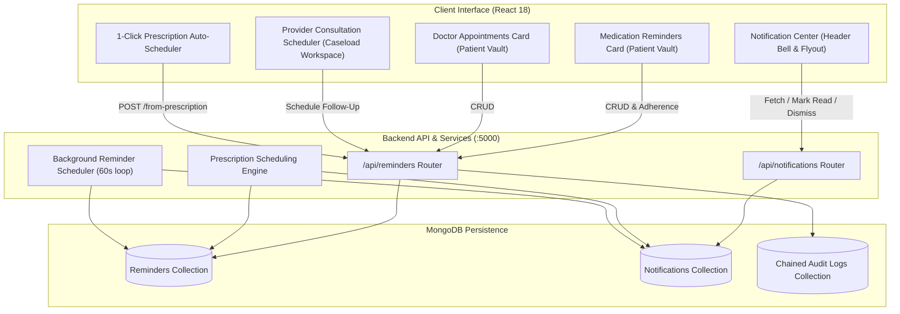

# HealthGrid Medication & Appointment Reminders with In-App Notification Center

## Feature Overview

The **Medication & Appointment Reminders** system enhances HealthGrid with clinical-grade adherence tracking, automated consultation alerts, prescription-driven scheduling, and a responsive In-App Notification Center.



---

## Core Capabilities

### 1. Medication Reminder Management & Adherence Tracking
- **Schema**: Tracks medication name, dosage, frequency (`daily`, `twice_daily`, `three_times_daily`, `weekly`, `as_needed`), scheduled time(s), instructions, and full historical log of dose adherence.
- **Interactive Adherence**: Patients can mark daily doses as **Taken** or **Skipped** with optional notes.
- **Audit Trails**: Every adherence recording or schedule modification is permanently logged in HealthGrid's SHA-256 chained audit ledger.

### 2. Doctor Appointment Reminders & Lead-Time Alerts
- **Specialist Details**: Captures doctor name, clinical specialty, hospital facility, location/room, appointment date, time, and clinical preparation notes.
- **Advance Alert Configuration**: Configurable advance alert windows (e.g. `1_day_before`, `2_hours_before`, `1_hour_before`, `3_days_before`).
- **Provider Workspace Integration**: Physicians can review upcoming consultations and schedule follow-ups directly from the patient dossier.

### 3. Prescription-Based Auto-Scheduling
- **Intelligent Frequency Parsing**: Detects Latin and clinical medical shorthands:
  - `BID` / `Twice daily` $\rightarrow$ 08:00 AM & 08:00 PM (2 doses/day)
  - `TID` / `Three times daily` $\rightarrow$ 08:00 AM, 02:00 PM, 08:00 PM (3 doses/day)
  - `QID` / `Four times daily` $\rightarrow$ 08:00, 12:00, 16:00, 20:00 (4 doses/day)
  - `HS` / `Bedtime` $\rightarrow$ 09:00 PM (Nightly)
  - `OD` / `Daily` $\rightarrow$ 08:00 AM (Morning)
- **1-Click Generation**: Both patients and providers can trigger auto-scheduling from active E-prescriptions.

### 4. Interactive In-App Notification Center
- **Live Counter**: Unread notification badge on the primary navigation header.
- **Categorized Visual Alerts**: Dedicated iconography for medication doses due (Emerald Pill), upcoming appointments (Blue Calendar), and prescription directives (Amber Alert).
- **Batch Operations**: "Mark all as read", filter by Unread/All, individual read toggles, and dismiss operations.

### 5. Backend Reminder Scheduler
- **Lightweight Cycle**: Runs an unreferenced background interval loop (every 60s) that checks for due doses and upcoming appointments.
- **Idempotent Delivery**: Prevents duplicate notifications for the same dosage time window within the same calendar day.
- **Graceful Lifecycle**: Hooks into server startup and cleanly stops on `SIGINT`/`SIGTERM` shutdown signals.
- **Manual Trigger**: Exposes `POST /api/reminders/trigger-check` for automated test suites and instant synchronization.

---

## API Endpoints Reference

| Method | Endpoint | Authorization | Description |
|---|---|---|---|
| `GET` | `/api/reminders` | Authenticated | List reminders (filtered by `type`, `status`, or `patient`) |
| `POST` | `/api/reminders` | Authenticated | Create a medication or appointment reminder |
| `PUT` | `/api/reminders/:id` | Authenticated | Update reminder fields or status |
| `DELETE` | `/api/reminders/:id` | Authenticated | Delete reminder from patient profile |
| `POST` | `/api/reminders/:id/adherence` | Authenticated | Record dose adherence (`taken` or `skipped`) |
| `POST` | `/api/reminders/from-prescription/:prescriptionId` | Authenticated | Auto-generate scheduled reminders from a prescription |
| `POST` | `/api/reminders/trigger-check` | Authenticated | Manually execute background scheduler cycle |
| `GET` | `/api/notifications` | Authenticated | Retrieve user notifications and unread badge count |
| `PUT` | `/api/notifications/:id/read` | Authenticated | Mark a single notification as read |
| `PUT` | `/api/notifications/read-all` | Authenticated | Mark all user notifications as read |
| `DELETE` | `/api/notifications/:id` | Authenticated | Dismiss / delete a notification |

---

## Verification & Test Suite

Run the full automated test suite covering all reminder and notification operations:

```bash
npm run test:reminders
```

All 22 test cases verify authentication, input validation, role-based authorization barriers, adherence state transitions, notification status updates, and scheduler triggers.
